# Industrial Defect Detection — Implementation Plan

**Version:** 1.0  
**Status:** Wave 1 implementation delivered; real-data gate open → MVP
**Scope reference:** [project-scope.md](./project-scope.md)

---

## 1. Purpose

This document defines how the project is built: wave gates, shared technical patterns, and the agent workflow. Machine learning comes before the interactive inspection UI. The web shell exists early so the contract is visible, but training does not run inside HTTP requests.

## 2. Current state and target

| Aspect | Wave 0 | MVP target |
| --- | --- | --- |
| Repository | Monorepo scaffold, catalogs, API shell, dashboard shell | Full layout in §4 |
| Models | Interfaces and configs only | Autoencoder + PatchCore |
| Dataset | Catalog of Bottle, Leather, Metal Nut | Local MVTec splits with no test leakage |
| Science | Protocols A, B, and C written | Three documented comparative runs |
| Quality | Ruff, Pytest, Vitest, Playwright smoke, CI | Green CI on the MVP paths |
| Deploy | Documented, not required to start | Frontend on Vercel, API on Railway |

## 3. Delivery model: waves

Waves are sequential gates. The next wave starts when the previous Definition of Done is met.

```mermaid
flowchart LR
  W0[Wave0_Foundation]
  W1[Wave1_Dataset]
  W2[Wave2_Preprocess]
  W3[Wave3_Autoencoder]
  W4[Wave4_PatchCore]
  W5[Wave5_Evaluation]
  W6[Wave6_Inference_UI]
  W7[Wave7_Comparison]
  W8[Wave8_Reports]
  W9[Wave9_Ship]
  W0 --> W1 --> W2 --> W3 --> W4 --> W5 --> W6 --> W7 --> W8 --> W9
```



| Wave | Name | Scope module | Primary deliverable |
| --- | --- | --- | --- |
| 0 | Foundation and agentic toolchain | Architecture, CI | Monorepo, catalogs, health API, dashboard shell |
| 1 | Dataset management | M01 | MVTec loader, counts, integrity checks, validation split from normal train images |
| 2 | Preprocessing | M02 | Recorded resize, normalization, and category-safe augmentation |
| 3 | Convolutional autoencoder | M03, M05 | PyTorch train loop, checkpoints, reconstruction error maps |
| 4 | PatchCore | M04 | Anomalib adapter, feature memory, anomaly maps, shared model interface |
| 5 | Evaluation and benchmark | M07 | Image and pixel metrics, validation thresholds, experiment A numbers |
| 6 | Inference lab | M06 | Upload, heatmap overlay, score, mask, downloads |
| 7 | Comparison dashboard | M08 | Side-by-side metrics and maps, latency |
| 8 | Reports and science | M09, experiments B and C | Markdown, CSV, JSON, PNG |
| 9 | Hardening and ship | Acceptance | Tests, English README, demo storyboard, deploy |

### Mapping to scope sprints

| Scope sprint | Waves | Milestone |
| --- | --- | --- |
| Sprint 1 — Dataset and foundations | 0, 1, 2 | Data pipeline |
| Sprint 2 — Autoencoder | 3 | Reconstruction model |
| Sprint 3 — PatchCore | 4 | Second algorithm |
| Sprint 4 — Evaluation | 5 | Reproducible benchmark |
| Sprint 5 — Web application | 6, 7 | Interactive inspection |
| Sprint 6 — Scientific documentation | 8, 9 | Publishable MVP |

## 4. Repository layout

```text
industrial-defect-detection/
├── frontend/
│   ├── app/
│   ├── components/
│   ├── features/datasets/
│   ├── features/inference/
│   ├── features/experiments/
│   ├── lib/
│   └── types/
├── backend/
│   ├── app/api/
│   ├── app/core/
│   ├── app/schemas/
│   ├── app/services/
│   ├── app/inference/
│   ├── app/visualization/
│   └── tests/
├── ml/
│   ├── configs/
│   ├── data/
│   ├── datasets/
│   ├── preprocessing/
│   ├── models/autoencoder/
│   ├── models/patchcore/
│   ├── training/
│   ├── evaluation/
│   └── experiments/
├── experiments/          # Protocols A, B, and C
├── docs/
├── scripts/
├── sample_outputs/
├── data/                 # Local MVTec copy, gitignored
├── AGENTS.md
├── .cursor/
└── .github/workflows/ci.yml
```

## 5. Technical spine

### 5.1 Separation of concerns

- `ml/` is pure numerical code. It does not import FastAPI or React.
- `backend/app/api/` decodes HTTP, checks catalogs, and encodes responses.
- `backend/app/inference/` loads prepared artifacts and calls `ml/` models.
- `frontend/` renders catalog metadata and results. It does not reimplement scores.

Training entry points are `scripts/` and `ml/training/`. A route that starts an epoch is a defect.

### 5.2 Catalogs

`ml/configs/categories.yaml` lists dataset categories.  
`ml/configs/models.yaml` lists algorithms and their status (`planned` or `ready`).  
`ml/configs/training_defaults.yaml` holds the RTX 3050 starting point.

The API and the UI read these files. A model stays `planned` until its wave lands a checkpoint loader.

### 5.3 Image convention

Decoded uploads are contiguous RGB `uint8` arrays, shape `(height, width, 3)`, range `[0, 255]`. Alpha is discarded. Training tensors are a later, documented conversion (resize and normalization) and must not silently change the HTTP boundary.

Limits: PNG or JPEG, 10 MiB, 4096 × 4096. Bytes exist only for the request.

### 5.4 Evaluation protocol

- Fit on normal train images.
- Choose thresholds only on the validation split.
- Report the official MVTec test split once.
- If validation is normal-only, document a target false-positive rate instead of tuning on anomalies.
- Record seed, image size, and config hash with every metric file.

### 5.5 Dependencies by wave

Wave 0 installs FastAPI, NumPy, Pillow, and PyYAML. PyTorch arrives in Wave 3. Anomalib arrives in Wave 4. Do not add those packages early.

## 6. Wave 0 definition of done

- Catalog endpoints return the three categories and two models.
- Inference routes validate input and respond that no artifact is ready.
- Dashboard routes render in English on a dark blue shell.
- `ruff`, `pytest`, frontend lint, unit tests, and production build pass.
- CI workflow matches that local loop.
- ADRs record image convention, train/test separation, and HTTP-versus-training.

## 7. Local commands

```bash
python -m venv .venv
.venv/bin/python -m pip install -e "./backend[dev]"
.venv/bin/uvicorn app.main:app --app-dir backend --reload --port 8000

cd frontend
cp .env.example .env.local
npm ci
npm run dev
```

Quality:

```bash
.venv/bin/ruff check --config backend/pyproject.toml backend ml scripts
.venv/bin/pytest backend
cd frontend && npm run lint && npm run test && npm run build
```
